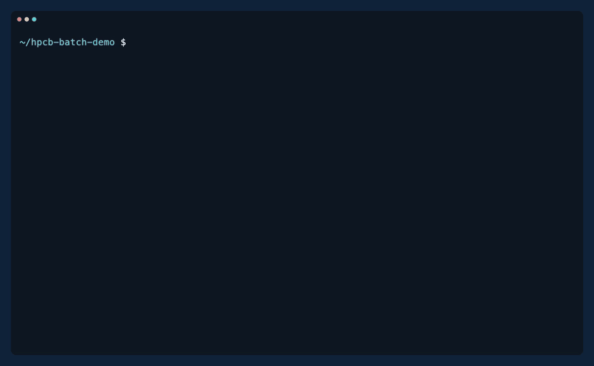
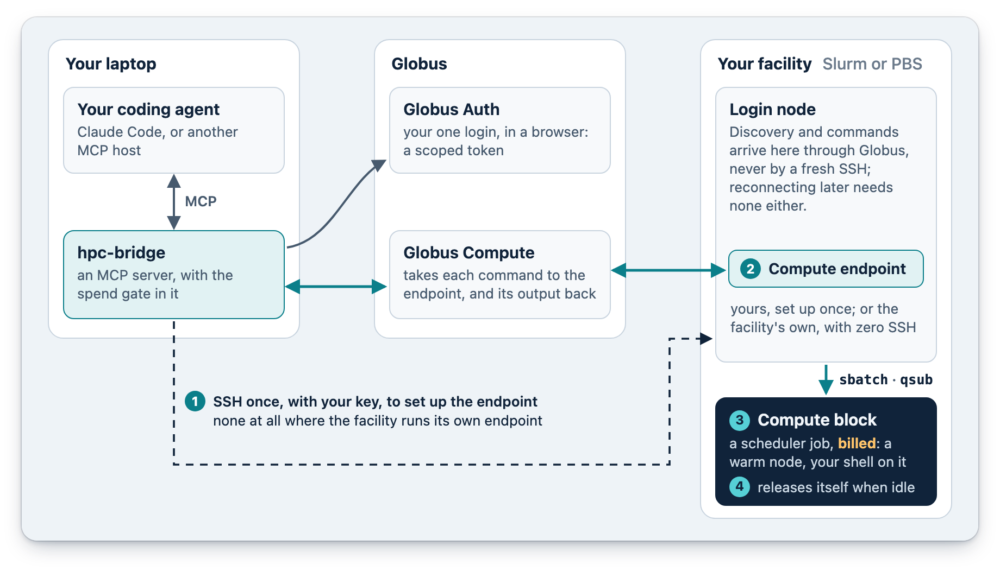

<p align="center">
  <picture>
    <source media="(prefers-color-scheme: dark)" srcset="https://raw.githubusercontent.com/globus-labs/hpc-bridge/main/docs/media/wordmark-dark.png">
    
  </picture>
</p>

<p align="center"><b>Drive a supercomputer from your coding agent.</b><br>
Ask for a compute node in plain language: the agent shows you what it will cost, asks, then runs your work on it.</p>

<p align="center">
  <a href="#install">Install</a> ·
  <a href="#your-first-session">First session</a> ·
  <a href="#how-it-works">How it works</a> ·
  <a href="docs/user/README.md">User guide</a> ·
  <a href="https://www.youtube.com/watch?v=uw9n9v657c8">Video</a>
</p>

<p align="center">
  
</p>
<p align="center"><sub>Claude Code connects to a small Slurm test cluster and shows the terms of the block it would start: its
partition, its size and the most it can bill. After a yes, six rows of a batch run on the block, two at a time, and
the block is released.</sub></p>

hpc-bridge is a Claude Code plugin, and an MCP server for any other agent host. It finds the facility you name, or
discovers a cluster you bring, and logs you in to Globus once. It sets up a Globus Compute endpoint on the login node,
or uses the facility's own, and starts a scheduler job sized to the work, a *block*, only after you say yes to what it
can cost. Your commands run there in a shell that keeps its place, and the block is released when you are done.

## Install

Inside Claude Code; the repository is its own plugin marketplace:

```text
/plugin marketplace add globus-labs/hpc-bridge
/plugin install hpc-bridge@hpc-bridge
```

Then ask: *What HPC facilities can I use?* That first answer needs no login and no configuration.

<details>
<summary><b>Other MCP hosts</b></summary>

hpc-bridge is a standard MCP server. Codex, Pi, Hermes, Claude Desktop, Cursor and the OpenAI Agents SDK all run the
same command:

```sh
uvx --python 3.13 --from git+https://github.com/globus-labs/hpc-bridge hpc-bridge
```

[Other MCP hosts](docs/user/other-hosts.md) has a tested recipe for each, and how to give the agent hpc-bridge's
guidance.
</details>

<details>
<summary><b>What you need</b></summary>

- [`uv`](https://docs.astral.sh/uv/) on your machine. It fetches Python 3.11 or newer itself.
- A Globus account, logged in with the identity your facility knows you by, usually your institution's or ACCESS's.
- An account at a facility: one that maps your Globus identity to it, for **zero SSH**, or one you reach with
  key-based SSH from `~/.ssh/config`.

You install nothing on the facility yourself. [Install](docs/user/install.md) has the details, and
[what you bring and what's included](docs/user/README.md#what-you-bring-whats-included).
</details>

## Your first session

1. *What HPC facilities can I use?*
2. *Connect me to Anvil*, a facility from step 1, or *the cluster at `login.example.edu`* for one that isn't listed
3. *Run `hostname` on a compute node*
4. *Release the compute block*

The connect opens your browser for Globus once. Before the first command, the agent names the block it would start
and asks. A block takes a couple of minutes to start on a quiet cluster; after that, commands run at once. The
[Quickstart](docs/user/quickstart.md) walks through each step.

## What it can do

### Commands on a warm node

Your working directory and environment carry over from one command to the next, as in a terminal. A long command
comes back as a task the agent polls, and keeps the block busy while it runs.

### Batches, sized per row

The same command over many inputs is one batch. You size a row as you would an sbatch array task, in cores, memory and
GPUs; hpc-bridge derives the block from the rows, pins each row to its own CPUs, and records every row in a ledger
that outlives the session. Not sure of the size? A pilot runs one row alone on the block and proposes one from what it
used.

### Jobs that outlive the session

Long or array work can go to the scheduler as jobs, under a budget you approve once: a cap and a deadline, with each
job's worst case counted against it. Jobs need a facility hpc-bridge reaches over SSH.

### Environments

Name an environment once, and every command, row and job runs in it: a `module load` or `conda activate` line on any
facility, or, where hpc-bridge set up the endpoint itself, one it builds from a requirements list on the login node,
for free. Switching environments starts no new block.

### The spend gate

Nothing billed starts without your yes. Before a block, a job or a batch that needs one, the agent shows its terms:
the partition, the account, the size, the walltime and the most it can bill, never understated. The check is in the
server, not in the agent's judgement.

### Picking up where you left off

A block an earlier session left running is named when you reconnect. A yes on the same terms reuses it, anything else
asks first, and a stop releases it, so a new chat never starts a second block beside it or calls it gone while it
bills.

## How it works

1. **SSH once, or not at all.** On the first connect, hpc-bridge uses your SSH key once to set up a Globus Compute
   endpoint in your home directory on the login node. Where the facility runs its own endpoint, your mapped Globus
   identity is the access, and there is no SSH at all.
2. **An endpoint on the login node.** From then on, discovery and commands travel through Globus with a scoped token.
   Reconnecting later needs no SSH.
3. **A billed compute block.** Once you say yes to its terms, the endpoint submits a Slurm or PBS job, and your
   commands run in a shell on its node, which stays warm between them.
4. **Idle self-release.** A stop cancels the block (on a facility's own endpoint, which can't cancel, the facility's
   idle timeout ends it), and a block left idle releases itself. Your own endpoint stays up between sessions, costing
   nothing.

<p align="center"></p>
<p align="center"><sub>The one SSH, dashed, sets up the endpoint. Everything after it, and everything on a facility that runs
its own endpoint, goes through Globus.</sub></p>

## Facilities

The public registry has five: **ALCF Polaris** (PBS), **Purdue Anvil**, **NCSA Delta** and **Globus Labs' cluster**,
each through the facility's own endpoint with zero SSH, and **SDSC Expanse** (Slurm), over SSH with a one-time code.
Any other Slurm or PBS cluster you reach with an SSH key works too: the agent probes its login node and proposes the
settings for you to confirm. [Facilities](docs/user/facilities.md) says what each one needs from you, and
[Adding a facility](docs/adding-a-facility.md) how a cluster joins the registry.

## Security and trust

After the one-time setup, every command carries a scoped Globus token and no SSH material, and SSH itself is key-only
and used once. The agent never handles a password: a facility that wants one gets an `ssh` command to run in your own
terminal, and only a one-time code ever passes through the chat. What the facility prints reaches the agent as data,
unfiltered, so read [Trusting the facility](docs/user/trust.md) before you connect to a cluster you don't fully trust.

## Status

**0.1.27.** Tested live, over its releases, on ALCF Polaris, Purdue Anvil, NCSA Delta, SDSC Expanse and UChicago's
Midway, and against a local Slurm and PBS test cluster; batches with sized rows and environments were proven on
Anvil. Each release's changes are in the [CHANGELOG](CHANGELOG.md). Please
[report rough edges](https://github.com/globus-labs/hpc-bridge/issues).

## Docs

- **[User guide](docs/user/README.md):** install, quickstart, facilities, the Globus login, costs and stopping,
  troubleshooting.
- **[Adding a facility](docs/adding-a-facility.md):** for facility staff and contributors.
- **[Vault](docs/hpc-bridge-vault/Home.md):** how it is built. [HANDOFF.md](HANDOFF.md) is where things stand today.

## Development

```sh
git clone https://github.com/globus-labs/hpc-bridge.git && cd hpc-bridge
claude --plugin-dir .                                    # Claude Code with this checkout as the plugin
python -m pytest -q                                      # unit tests: hermetic and fast
python -m pytest agentic/harness/test_invariants.py -q   # the agentic grading core, also hermetic
uv run ruff check .                                      # lint
uv run --with mypy python -m mypy                        # types
```

`agentic/` also holds a live-agent regression tier, which drives a real cluster and costs money; see its
[README](agentic/README.md). `scripts/readme-media/build.sh` remakes this README's images.

## Licence

hpc-bridge is licensed under the [Apache License 2.0](LICENSE).
