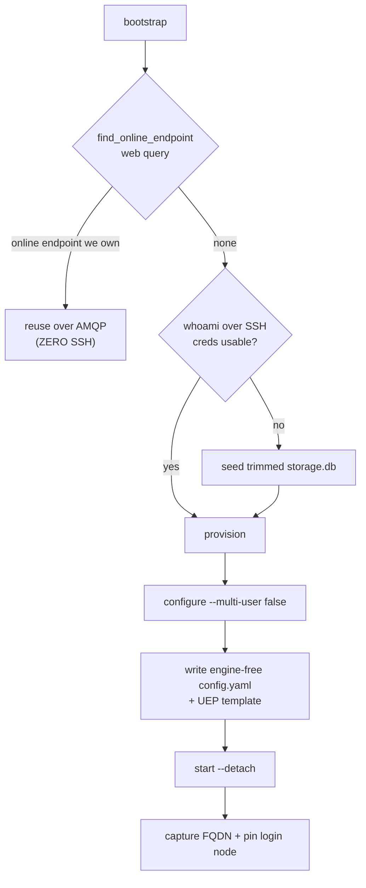

# Standing up the endpoint

> [!abstract] In one line
> First connect: **reuse an already-online endpoint over the web (zero SSH)**, else SSH once to seed credentials, write the manager + UEP config, `start` the daemon detached, and **pin** the login node it landed on.

## The flow

`SlurmFacility.bootstrap()` ([[facility-remote]], `remote.py:714`) is the entry, and it is **reuse-or-SSH**:

- **Reuse first** (`find_online_endpoint`, `remote.py:821`) — a still-running endpoint from a prior session is reused over AMQP with no SSH. This is the [[Two-channel architecture|SSH-once]] keystone, and the reattach is now **surfaced** on the connect result (`ConnectFacilityResult.reused`) instead of being silent ([#20](https://github.com/globus-labs/hpc-bridge/issues/20)).
- **Credentials** — seeded only if the remote can't already authenticate (`whoami`). See [[Credential seeding]].
- **Provision** (`remote.py:753`) — a locally-"Running" endpoint is **re-adopted with no probe** (a probe can't tell a cold worker from a hang); a fresh name is `configure`d (forced `--multi-user false`); a stopped/configured one being **re-`start`ed first has its stale per-UEP `daemon.pid` files cleared** (scoped to the endpoint UUID) so the rebuilt worker can't hit "Another instance is running" → exit 73 ([#37](https://github.com/globus-labs/hpc-bridge/issues/37)). Then write the engine-free manager `config.yaml` + the [[MEP & templated endpoints|UEP template]] → `start --detach`.
- **Pin** — record the login node so the next session reconnects directly ([[state]]).

> [!warning] Login-node pinning
> The manager lives on ONE login node, but the SSH alias round-robins. `start` (`remote.py:386`) captures the FQDN *in the same SSH connection* that launches the daemon — a separate `hostname -f` could resolve a different node and orphan the manager on teardown. The FQDN is stored by [[state]]'s `LoginNodeStore`; the CLI `rebind`s there next session — **unless `_routable_pin` drops it as non-routable** (an internal `.local`/`.internal` name, or a management-plane name like Aurora's `aurora-uan-0009.hostmgmt.cm.aurora.alcf.anl.gov`), in which case it stays on the alias ([[facility-remote]], [#33](https://github.com/globus-labs/hpc-bridge/pull/33)).

> [!note] Idempotent
> Bootstrap reuses a running endpoint, seeds credentials only when absent, and re-writes config on every provision so the current profile always applies.

> [!note] A facility MEP skips all of this
> A `compute_mep_uuid` entry binds a [[facility-mep|`MEPFacility`]] whose `provision` just returns the catalogued UUID with `reused=True` — the facility runs the manager and maps our Globus identity to a local account, so there is nothing to seed, configure or start, and `connect_facility` only *attaches* (`_connect_mep`, [[server]]).

## What a newcomer sees when SSH fails

The bootstrap's first SSH is where a stranger with no account on the facility fails, and the raw error named an internal step (`seed storage.db (mkdir) failed: u@host: Permission denied (publickey,…)`). `_explain_provision_error` ([[server]], `server.py:170`) rewrites it into what they can act on: **`NO SSH ACCESS to <host> as <user>`** — which host and login name were tried, *where the name came from* (`HPC_BRIDGE_SSH_USER`, `~/.ssh/config`, or nowhere ⇒ the local username), the remedies (put `User`/`IdentityFile` in `~/.ssh/config` or set the env overrides; on an MFA facility pre-open a session), and "nothing was started or billed" — or **`CANNOT REACH <host>`** for a resolve/timeout/refused failure, or a hint to shorten `HPC_BRIDGE_STATE_DIR` for `ControlPath too long` (found on the stranger's walk, [#50](https://github.com/globus-labs/hpc-bridge/issues/50)). A host that *offers* an interactive method instead raises `NeedsPreauth` → `needs_preauth` ([[MFA and interactive SSH auth]]). On `main` this explanation covers the bootstrap path; the discovery-probe path (`_propose_or_ask`) still returns the raw `discovery over SSH to … failed` text — PR [#51](https://github.com/globus-labs/hpc-bridge/issues/51) (open) routes it through the same explainer.

## The endpoint's own venv: checked, not trusted (2026-10-10)

A facility with no endpoint installed gets one from `env_setup`: the line that [[discovery]] proposes (`venv_env_setup` / `uv_env_setup` / `pip_env_setup`; the Expanse seed holds the same generator's output) self-provisions hpc-bridge's own venv. It used to guard with `[ -d {venv} ] ||` and `command -v globus-compute-endpoint ||`, which trust anything that is there. Found live on globus1: every test account had a venv from 2026-07-01 (Python 3.12.3, gce 4.13.0) whose globus-sdk had moved to 4.8.1. The CLI failed at import (`cli` → `auth`), every first bring-up failed with `remote configure failed: Traceback…`, and the agent improvised pip repairs.

**One venv per endpoint version and Python.** The venv is `{venv}-endpoint-<gce>-py<X.Y>` (`keyed_venv`; `{venv}` = `DEFAULT_REMOTE_VENV` `/home/{user}/hpc-bridge/gce-venv`, or `HPC_BRIDGE_REMOTE_VENV`). A pin move, a different client Python or another plugin version builds a new venv beside the old one, so a manager still running from the old one, and that manager's blocks, keep it. A venv is rebuilt in place only when its own check fails. The `-endpoint-` stem keeps it apart from the facility-MEP seeds' worker venvs: Delta and Anvil use `$HOME/hpc-bridge/gce-venv-<gce>-py<X.Y>` and upgrade it on every block. A test checks that no seed's venv equals one of ours.

**The check** goes through the entry point the manager runs: `"$venv/bin/globus-compute-endpoint" version` must print `Globus Compute endpoint version: <pin>`, and `"$venv/bin/python"` must be the client's major.minor (task functions are dill'd by it). It cannot be `python -c "import globus_compute_endpoint.cli"`: gce 4.12–4.18's `cli.py` reads `sys.argv[0].rsplit("/", 1)[1]` at import, which raises IndexError under `-c`. An earlier draft of this fix used it and failed every bring-up on a real install; stub tests with an empty `cli` missed it. When the check passes, it records `uname -m` in `.hpcb-arch`; when it fails, `$__hb_why` keeps the last line of the error, and the build prints it.

The plugin tells the line where it runs (`_env_prefix`, [[facility-remote]]): `HPCB_ENV_REPAIR=1; ` on the bring-up calls (`whoami`, `configure`, `start`, the 900 s ones), `=0; ` on the rest. It is a plain shell variable, not exported.

| Where | What the line does |
|---|---|
| a **compute worker** (`${SLURM_JOB_ID:-}${PBS_JOBID:-}` set; checked first, so a leaked flag cannot reach it) | runs the keyed venv's entry point and never builds. Only a MISSING keyed venv falls back, to the unkeyed `{venv}` when its entry point runs: what a manager started by a plugin up to 0.1.22 runs from. A broken one does not fall back. Failure: **"hpc-bridge: the endpoint venv … (built on x86_64) does not run on spark1 (aarch64); see the error above"** and `exit 1`, ending the job instead of a later bare exit |
| `HPCB_ENV_REPAIR=0` (`list`, `stop`, `delete`; teardown's are 30 s calls) | never builds. The keyed venv if its entry point exists (`-x`, so a half-built venv is not trusted), else the first working venv among `{venv}` and `{venv}-endpoint-*` (candidates from `find`, so a `failglob` shell cannot abort the loop; moved-aside and lock directories skipped). That covers a new plugin that adopted an older endpoint over the web and now tears it down. Nothing working: **"no working hpc-bridge venv beside …"** |
| `HPCB_ENV_REPAIR=1` | the full check; on failure, a build |
| no flag (a plugin up to 0.1.22 reading a re-ingested seed) | the keyed venv if it works; else, when it is MISSING, the unkeyed `{venv}` if its entry point runs; else a build. Such a plugin never breaks a setup that worked, and its workers fall back the same way |

**The build** (`__hb_build`):
1. Create the parent directory. Failure means "cannot create …", at once: a missing home, a full quota.
2. Take a `mkdir <venv>.lock`. A lock that cannot be created and does not exist fails at once ("cannot create ….lock: Disk quota exceeded"). One that exists is waited for (up to ~400 s in 2 s steps); one older than 15 minutes, past any bring-up's ssh timeout, is a dead build's and is taken over. Two waiters can both judge it stale and both build; the re-check makes that rare.
3. Ignore SIGPIPE. A session dropped with no pty leaves the shell running, writing to a closed pipe, so it still restores and releases.
4. Check again (another session may have just built it), and refuse a directory without `pyvenv.cfg` ("exists and is not a venv: move it away").
5. Arm an undo on HUP/INT/TERM, then move the old venv aside to a unique `<venv>.old.<pid>[x…]`. `mv` works on NFS where `rm -rf` fails on silly-renamed `.nfs*` files; if `mv` itself fails, nothing is touched.
6. Create and install the pin with `globus-sdk` co-pinned to the client's, then check. A repair (an old venv existed) installs without the package cache (`--no-cache`, `--no-cache-dir`), so a corrupt cached file cannot come back. That happened live, with a hardlinked `cli.py` shared with `~/.cache/uv`.
7. On success, disarm the undo and remove the moved-aside venv best-effort; leftovers are harmless. On failure, undo: remove only the venv this build created, put the old one back, release the lock. Then stop with **"could not build globus-compute-endpoint X (Python Y) in …: <why>"** before gce runs.

A SIGKILL mid-build cannot be trapped. It leaves the half-built venv at the keyed path, the old one at `.old.<pid>`, and the lock. The next bring-up waits, takes the lock over after 15 minutes, finds the keyed venv failing its check, moves it aside and builds. The `.old.<pid>` stays until removed by hand, and a `=0` stop in between uses another working venv.

**What a block runs.** Every task's `user_endpoint_config` carries `worker_init`, as it always did. Its value is the endpoint's OWN configured one: `SlurmFacility.adopt_endpoint` reads it from the endpoint's published template (`get_endpoint_metadata` → `user_config_template`, parsing our template line's default, encoded once by plugins up to 0.1.22 and twice since). `warmth._provision` calls it once per endpoint id, before the first runner exists, on every path to an endpoint (bootstrap, web reuse, the MFA pre-check, a BYO UUID). `dispatch_uec` sends it. Unreadable metadata, or a template that is not ours, falls back to the profile's worker_init, the old behaviour. So an endpoint configured by an older plugin, or before an edit, keeps running what its manager was started with. When that differs from the facility's current env_setup, the connect result and a FINISHED-pilot notice both say: **"this endpoint runs with the environment it was started with …: teardown_endpoint, then connect_facility, to apply the new one"**. That stops an agent editing again after every failed block. The template's own default is JSON-encoded twice, so it also reaches the YAML intact (the line contains `: `) when a task carries none. Rendering is tested with gce 4.18's own sanitizer, sandboxed Jinja and `safe_load`. A non-BMP character (an emoji) is mangled on every path, before and after this change: gce's sanitizer `json.dumps` it to a surrogate pair that PyYAML does not recombine.

**Cached configs are migrated.** A returning user's facilities.json still holds the line an earlier discovery generated, and a reconnect never re-probes. `binding._entry_from_details` replaces an env_setup that EXACTLY matches one of the lines discovery generated up to 0.1.22 (uv, pinned uv, bootstrap, module uv, module pip; `{venv}` templated or resolved) with the current generator's, at this client's Python and pin. A hand-written line never matches and is never touched.

**How an architecture mismatch is caught.** globus1's login node is x86_64 and its compute nodes are aarch64 DGX Sparks on a shared NFS home (2026-10-10, job 1108 `FAILED 2:0` on spark1). The venv's python is uv's x86_64 build, so the worker's entry point fails with `Exec format error`. The message names the architecture the check last passed on (the `.hpcb-arch` marker; `unknown` for a venv no bring-up has checked) next to the node's `uname -m`. The pilot probe ([[scheduler_ops]]) reports the pilot FINISHED and points at the job's stderr.

The [[discovery]] probe checks the same way, through the entry point with bytecode writes off and each check capped at 20 s by `timeout`. A cap that hits is reported as "timed out", not BROKEN. For a gce on PATH the probe reads the interpreter from the shebang, or from a `/bin/sh` launcher's exec line (uv's quoted form, pip's quoted or bare). So the proposal says "reused", "rebuilt" or "BROKEN" before anything runs. `tests/test_env_setup.py` runs the line in real shells (bash, plus sh and dash where installed) against stubs that behave like gce (the `argv[0]` read at import, uv's trampoline, the real `version` line), and optionally against a real install (`HPCB_TEST_REAL_GCE_VENV`).

> [!warning] Known gaps
> - **Old venvs accumulate.** Every pin or Python move leaves the previous venv (a few hundred MB) in `~/hpc-bridge/`, plus any `*.old.*` that NFS would not let go. Nothing cleans them up: deleting a venv a manager may still run from is the bug this design avoids. Users with a tight home quota remove the unused ones by hand (documented in `docs/user/facilities.md`); a full quota now fails fast with "cannot create …".
> - **Same keyed venv, failing its check, manager running** (it drifted after the manager started): the bring-up moves it aside and rebuilds. The running manager's open files survive the `mv`, but its lazy imports do not. Its blocks keep the endpoint's own worker_init, so they get the rebuilt venv at the same path. Such a venv cannot start a manager any more either.
> - **The adopt-on-start race.** `provision` writes the UEP template before `start`; if `start` then adopts a manager another plugin version had started, the template on disk is ours. The metadata read afterwards still names the adopted manager's own worker_init, which is what is sent.
> - **The unkeyed `{venv}` is shared.** On globus1 the globus-cluster MEP seed's worker_init uses `$HOME/hpc-bridge/gce-venv`, the same path older plugins built for BYO and that the `=0` and no-flag fallbacks may pick. That is fine for stop/delete (any working gce will do), but it is the MEP's install, at the MEP's version. The MEP seed's `[ -d ] ||` guard still keeps a venv built on another Python; MEP worker_init was not changed.
> - The no-flag mode with a BROKEN keyed venv and a working unkeyed one builds (a repair), inside whatever call it is, including an old plugin's 30 s stop.

> [!todo] Follow-up: a venv per architecture
> Not built. The idea: key the venv by `$(uname -m)` too, so a compute node of another architecture builds its own on first use. Why not now:
> 1. The build would move onto the compute node, inside a billed job, and needs outbound network there (often absent).
> 2. Concurrent blocks on first use would race. The lock above would serve, but venvs are not relocatable (pip's are not, uv's only with `--relocatable`).
> 3. uv in `~/.local/bin` is the login node's architecture, so it would also have to be per-architecture, and so would the astral installer's target.
> 4. The worker venv must install exactly what the login venv has (parsl's interchange↔worker protocol, the 2026-10-06 skew), so it would need the login venv's frozen requirements, with wheels for all of them on the other architecture.
>
> Until then, a facility like that needs a partition of the login node's architecture, or a facility-provided environment on both (a site module).

## See also
[[Two-channel architecture]] · [[Credential seeding]] · [[MEP & templated endpoints]] · [[facility-remote]] · [[facility-mep]] · [[state]] · [[Discovery today]] · [[login]]
