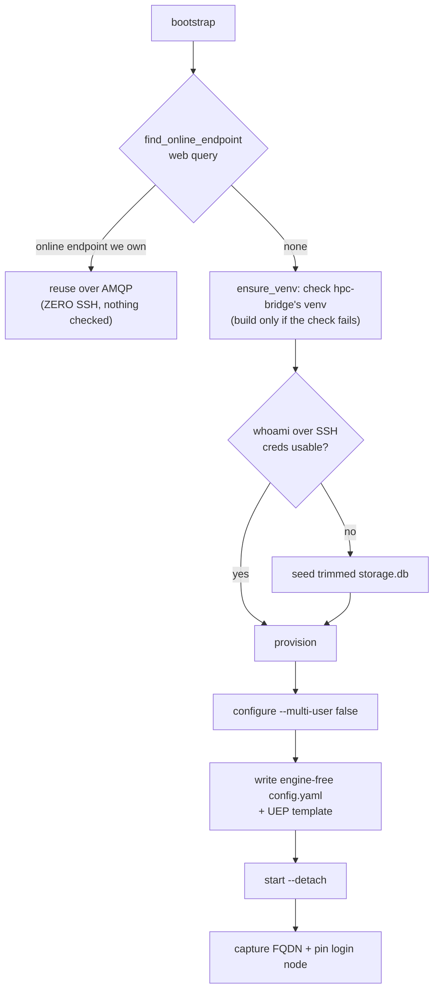

# Standing up the endpoint

> [!abstract] In one line
> First connect: **reuse an already-online endpoint over the web (zero SSH)**, else SSH to check (and if needed build) hpc-bridge's own endpoint venv, seed credentials, write the manager + UEP config, `start` the daemon detached, and **pin** the login node it landed on.

## The flow

`SlurmFacility.bootstrap()` ([[facility-remote]], `remote.py:1177`) is the entry, and it is **reuse-or-SSH**:

- **Reuse first** (`find_online_endpoint`, `remote.py:1422`) — a still-running endpoint from a prior session is reused over AMQP with no SSH. This is the [[Two-channel architecture|SSH-once]] keystone, and the reattach is now **surfaced** on the connect result (`ConnectFacilityResult.reused`) instead of being silent ([#20](https://github.com/globus-labs/hpc-bridge/issues/20)).
- **The endpoint venv** — when env_setup is hpc-bridge's own line, `RemoteEndpointCLI.ensure_venv` (`remote.py:451`) checks the keyed venv before anything runs through it, and builds it only when the check fails. See *The endpoint's own venv* below.
- **Credentials** — seeded only if the remote can't already authenticate (`whoami`). See [[Credential seeding]].
- **Provision** (`remote.py:1267`) — a locally-"Running" endpoint is **re-adopted with no probe** (a probe can't tell a cold worker from a hang); a fresh name is `configure`d (forced `--multi-user false`); a stopped/configured one being **re-`start`ed first has its stale per-UEP `daemon.pid` files cleared** (scoped to the endpoint UUID) so the rebuilt worker can't hit "Another instance is running" → exit 73 ([#37](https://github.com/globus-labs/hpc-bridge/issues/37)). Then write the engine-free manager `config.yaml` + the [[MEP & templated endpoints|UEP template]] → `start --detach`.
- **Pin** — record the login node so the next session reconnects directly ([[state]]).

> [!warning] Login-node pinning
> The manager lives on ONE login node, but the SSH alias round-robins. `start` (`remote.py:676`) captures the FQDN *in the same SSH connection* that launches the daemon — a separate `hostname -f` could resolve a different node and orphan the manager on teardown. The FQDN is stored by [[state]]'s `LoginNodeStore`; the CLI `rebind`s there next session — **unless `_routable_pin` drops it as non-routable** (an internal `.local`/`.internal` name, or a management-plane name like Aurora's `aurora-uan-0009.hostmgmt.cm.aurora.alcf.anl.gov`), in which case it stays on the alias ([[facility-remote]], [#33](https://github.com/globus-labs/hpc-bridge/pull/33)).

> [!note] Idempotent
> Bootstrap reuses a running endpoint, seeds credentials only when absent, and re-writes config on every provision so the current profile always applies.

> [!note] A facility MEP skips all of this
> A `compute_mep_uuid` entry binds a [[facility-mep|`MEPFacility`]] whose `provision` just returns the catalogued UUID with `reused=True` — the facility runs the manager and maps our Globus identity to a local account, so there is nothing to seed, configure or start, and `connect_facility` only *attaches* (`_connect_mep`, [[server]]).

## What a newcomer sees when SSH fails

The bootstrap's first SSH is where a stranger with no account on the facility fails, and the raw error named an internal step (`seed storage.db (mkdir) failed: u@host: Permission denied (publickey,…)`). `_explain_provision_error` ([[server]], `server.py:170`) rewrites it into what they can act on: **`NO SSH ACCESS to <host> as <user>`** — which host and login name were tried, *where the name came from* (`HPC_BRIDGE_SSH_USER`, `~/.ssh/config`, or nowhere ⇒ the local username), the remedies (put `User`/`IdentityFile` in `~/.ssh/config` or set the env overrides; on an MFA facility pre-open a session), and "nothing was started or billed" — or **`CANNOT REACH <host>`** for a resolve/timeout/refused failure, or a hint to shorten `HPC_BRIDGE_STATE_DIR` for `ControlPath too long` (found on the stranger's walk, [#50](https://github.com/globus-labs/hpc-bridge/issues/50)). A host that *offers* an interactive method instead raises `NeedsPreauth` → `needs_preauth` ([[MFA and interactive SSH auth]]). On `main` this explanation covers the bootstrap path; the discovery-probe path (`_propose_or_ask`) still returns the raw `discovery over SSH to … failed` text — PR [#51](https://github.com/globus-labs/hpc-bridge/issues/51) (open) routes it through the same explainer.

## The endpoint's own venv: checked, not trusted (0.1.24)

A facility with no endpoint installed gets one from hpc-bridge: the env_setup that [[discovery]] proposes is hpc-bridge's own line ([[facility-endpoint_venv]]). **The line only activates; the build is Python.** (Why, and what came before it: [[Next priorities 2026-10]] → Follow-ups A.)

**One venv per endpoint version and Python.** The venv is `{venv}-endpoint-<gce>-py<X.Y>` (`keyed_venv`; `{venv}` = `$HOME/hpc-bridge/gce-venv`, which the login node expands, or `HPC_BRIDGE_REMOTE_VENV`; it was `/home/{user}/…` until 2026-10-29, which is not the home everywhere: NERSC's are `/global/homes/<x>/<user>`). The pin is the client's SDK version (released in lockstep with the endpoint); the Python is the client's major.minor (task functions are dill'd by it). A version or Python move builds a new venv beside the old one, so a manager still running from the old one, and its blocks, keep it. The `-endpoint-` stem keeps clear of the facility-MEP seeds' worker venvs (Delta's and Anvil's `$HOME/hpc-bridge/gce-venv-<gce>-py<X.Y>`; globus-labs uses the unkeyed path itself); a test checks every seed.

**The line** (~460 characters) does what `bin/activate` does — unsets PYTHONHOME (first, so a site's PYTHONHOME cannot break the worker's check), sets VIRTUAL_ENV and puts the keyed venv's `bin` on PATH — without sourcing `bin/activate`, which a relocated venv cannot use under sh/dash. Only when the keyed DIRECTORY is missing does it use the unkeyed `{venv}`, if that exists: what an endpoint started by a plugin up to 0.1.23 runs from, a venv the user prepared, and what an older plugin reading a newer line finds. A keyed directory that exists is used even if broken (a venv only ever arrives there whole, so a block starting mid-build cannot fall back to globus1's MEP install). On a worker (`${SLURM_JOB_ID:-}${PBS_JOBID:-}` set) it runs the entry point's `version`; on failure it prints **`hpc-bridge: endpoint venv <path> (built on <arch>) does not run on <host> (<arch>)`** and `exit 1`, so the job ends there instead of later with a bare exit code. `<arch>` comes from the `.hpcb-arch` marker the build writes. It never builds.

**The build** (`endpoint_venv.ensure`), a few short SSH commands, only on a bring-up and never on stop/delete/list:
1. Check the keyed venv: the entry point's `version` must report the pin, and `<venv>/bin/python -c 'import sys;print(sys.version_info[:2])'` must be the client's Python; Python parses both. A check that times out is reported, not rebuilt. OK ⇒ write `.hpcb-arch` if it is missing, done.
2. Keyed venv missing ⇒ check the unkeyed `{venv}` the same way; if it passes (a prepared venv on a login node with no internet, or an older plugin's at this pin), use it as it is.
3. Otherwise refuse a non-venv directory at the keyed path, then build a relocatable venv in a directory of its own, `<keyed>.build.<token>`: `uv venv --relocatable --no-cache --python X.Y`, then `uv pip install --no-cache --link-mode=copy` gce and globus-sdk at the client's versions (the endpoint leaves globus-sdk unbounded; a fresh resolve is what broke globus1), then the marker. Our own `.build.*` dirs hours old (a dropped session's) are removed first. A node with no uv gets one first in `~/.local/bin` (astral.sh's installer with `UV_NO_MODIFY_PATH=1`, so no shell profile is edited; else pip in a throwaway venv), and the build runs uv by its path; a node whose uv predates `uv venv --relocatable` (0.2.31) gets an error naming that uv instead. One SSH command, 900 s, capped at 840 s on the node by `timeout` and named by the token.
4. Verify the build where it is, with the same check.
5. Claim the keyed path in one step, run by the build's own python: if the path still holds the very directory the check saw (same inode), move it aside to a per-bring-up `.broken.<time>.<token>` and check the moved directory's inode again (another bring-up's venv renamed in at that instant goes back, and ours has lost); then `os.rename(build, keyed)`, which refuses a non-empty target. Only ENOTEMPTY/EEXIST read as a lost race; any other rename error is reported as itself and the verified build kept. Two bring-ups that build at once both finish; the one whose rename loses discards its own build, re-checks and uses the winner's. **There is no lock** — nothing to wait for, take over or leave stale.
6. A build that fails or does not verify is kept as `.failed.<time>` (the message names it, or says nothing was kept) with the error's last line reported; a verified build whose claim hits an ssh blip, or whose verify only timed out, is left where it is; a cancelled bring-up stops its build by the token's process group and discards it. Nothing that worked is ever deleted.

**Teardown never builds, and runs the CLI where the endpoint was started.** stop/delete/list use the environment the endpoint was STARTED with: its own worker_init when this process read it (`adopt_endpoint`) or started it (`provision` records the profile's line as the endpoint's own), else unknown. A reconnect may have changed env_setup since. Live on globus1 (2026-10-13), an agent emptied it to "fix" an architecture mismatch, and the teardown ran a bare `globus-compute-endpoint`: `command not found`, and the manager kept running.
- Started with a hand-written line, or with none: exactly that, with no search.
- Started with hpc-bridge's line (a line an earlier hpc-bridge generated is read as the short one, never run, since it builds): its venv if this process checked exactly that one, else the first candidate whose `version` runs. The candidates are the line's keyed venv, its unkeyed one, the default `$HOME/hpc-bridge/gce-venv`, then other `<base>-endpoint-*` dirs of each base (newest first), each once, skipping builds and moved-aside dirs (`endpoint_venv.find_working`, 6 s per candidate, no new one 18 s after the search starts).
- Start unknown: the same search, from env_setup's venv when env_setup is hpc-bridge's line, else from the default.
- When the search can't tell (its ssh timed out, a candidate only ran out of time, the deadline left some untried), or nothing says the endpoint is ours and none of hpc-bridge's venvs runs, the stop is tried through the line it was started with, else through env_setup.
- None of hpc-bridge's venvs runs for a line of hpc-bridge's: the blocks are still cancelled (no CLI needed), and the teardown says the manager must be stopped by hand.

The choice serves that one teardown: `end_teardown` drops it in the teardown's `finally`, and every bring-up's `ensure_venv` drops it too, so the next start never runs in a torn-down endpoint's venv. A reconnect that replaces hpc-bridge's line on a running endpoint gets a WARNING in its notice (`worker_init_note`).

**What a block runs.** Every task's `user_endpoint_config` carries `worker_init`, set to the endpoint's OWN configured one: `SlurmFacility.adopt_endpoint` (`remote.py:1074`) reads it from the endpoint's published template (`get_endpoint_metadata`, parsing our template line's default, encoded once up to 0.1.23 and twice since; an ambiguous once-encoded JSON string prefers the reading equal to the profile's). `warmth._provision` calls it on every path to an endpoint id, before the first runner exists; `dispatch_uec` sends it. Only a read that succeeded is cached. After a `start` hpc-bridge did itself, `provision` records that endpoint as adopted with the profile's own line and reads nothing: on a restart under the same id the daemon re-registers seconds after `start` returns, so the web would still serve the old template. So an endpoint configured by an older plugin keeps running what its manager was started with. When its line differs from the facility's current one beyond the upgrade-on-read below, the connect result and a FINISHED-pilot notice say so, conditionally: **"Only if its blocks fail or you changed env_setup: teardown_endpoint, then connect_facility"**. The template default is JSON-encoded twice so it also reaches the YAML intact (the line contains `: `) when a task carries none.

**Upgrade-on-read.** An env_setup that EXACTLY matches a line hpc-bridge generated up to 0.1.23 (discovery's guarded uv, pinned uv, bootstrap, module uv and module pip lines, `{venv}` templated or resolved; the Expanse seed's bootstrap line with its double-quoted pin) is read as the short line, in `profile_from_catalog_entry`, for facilities.json entries and registry entries alike. The stored text is not changed: the Expanse seed keeps its old text (no re-ingest), plugins up to 0.1.23 reading the registry keep working, and newer ones upgrade it. hpc-bridge's own line keyed for another version is re-keyed to the client's. Hand-written text is never touched.

**`details.env_setup` is optional.** The server keeps the last proposed draft per facility id (`AppCtx.proposed_drafts`); a `details=` without env_setup takes the proposal's (same `ssh_host` only), and the proposal's notice tells the agent to leave it out unless the user wants it changed. With no proposal, the connect fails clearly. The agent never has to echo the line.

**How an architecture mismatch is caught.** The worker's line ends the job with the message above. The pilot probe ([[scheduler_ops]]) reads, for each pilot that FINISHED with an exit status, that job's own stderr (Slurm: SubmitLine's script + `.stderr`; PBS: Error_Path), and quotes an exact `hpc-bridge: endpoint venv …` line in the FINISHED notice. When the two architectures differ it says a rebuild cannot help (the venv is built on the login node again), tells the agent NOT to change env_setup (no env_setup changes the architecture, and the running endpoint keeps its own), and points at a partition of the login node's architecture or the facility's own multi-user endpoint if `list_facilities` has one; when they match it offers teardown + connect. A later pilot (another partition) is never told what an earlier one said.

`tests/test_env_setup.py` runs the line in real shells (bash, sh, dash) against stubs that behave like gce (`argv[0]` read at import, uv's trampolines, relocatable ones included, the real `version` line) and, opt-in, against a real install (`HPCB_TEST_REAL_GCE_VENV`). `tests/test_endpoint_venv_build.py` covers every build branch with a fake login node, and runs the same scripts in a real shell (concurrent builds, a claim lost to another bring-up, a cancel). The agentic scenarios `venv_broken_repair`, `venv_arch_mismatch` and `endpoint_upgrade_reuse` exercise it on the fake cluster.

> [!warning] Known gaps
> - **Old venvs accumulate.** Every pin or Python move leaves the previous venv (a few hundred MB) under `~/hpc-bridge/`, plus `.broken.*`, `.failed.*` and any `.build.*` a dropped session left. Nothing cleans them up: deleting a venv a manager may still run from is what this design avoids. Users with a tight quota remove them by hand (`docs/user/facilities.md`).
> - **A keyed venv that fails its check while a manager runs from it** is moved aside and replaced at the same path. The running manager keeps its open files but not its lazy imports; its blocks get the new venv.
> - **No `timeout` on the login node**: the build is not capped there, and a cancel stops only the build's own process group. A site uv older than `--relocatable` (0.2.31) is named in the error; hpc-bridge does not replace it.
> - **A venv per architecture** is designed, not built: [[Per-architecture endpoint venvs]].

## See also
[[Two-channel architecture]] · [[Credential seeding]] · [[MEP & templated endpoints]] · [[facility-remote]] · [[facility-endpoint_venv]] · [[facility-mep]] · [[state]] · [[Discovery today]] · [[login]] · [[Per-architecture endpoint venvs]]
